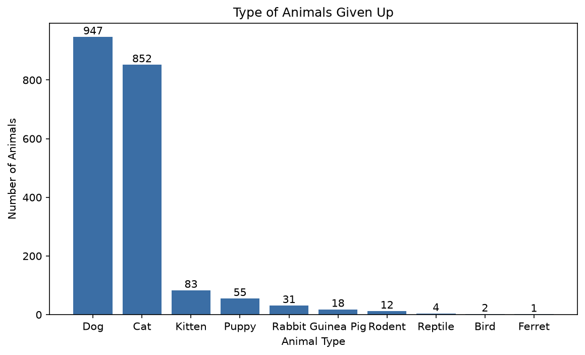
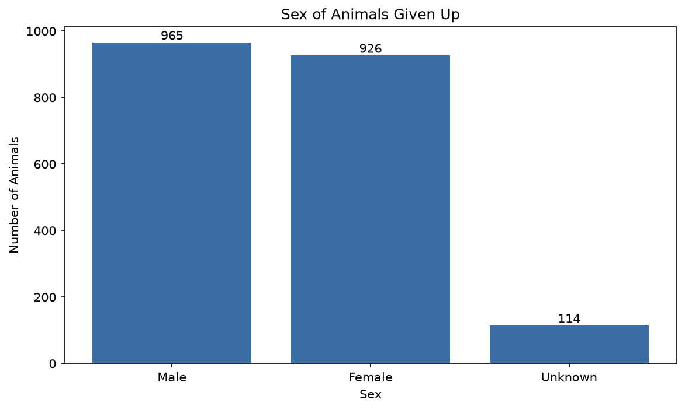
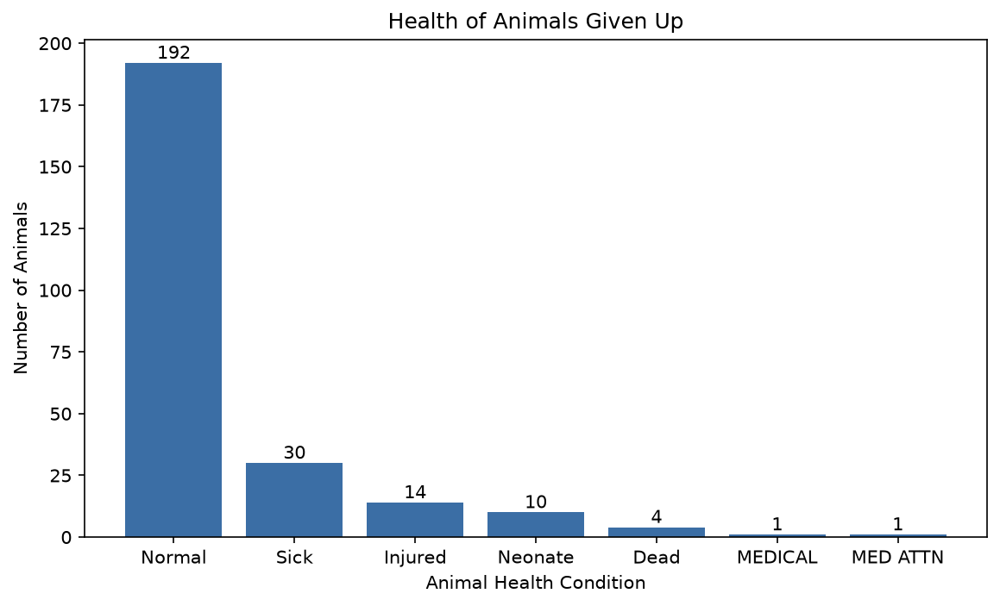
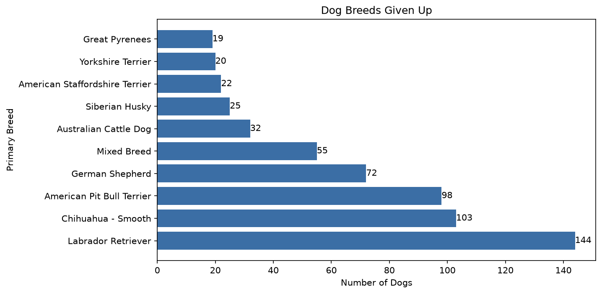
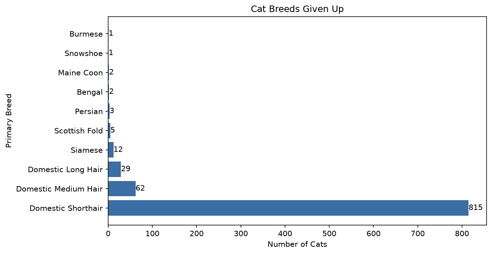

## Who Gets Surrendered? Animal Intakes at the Austin Animal Center
Which animal characteristics like the sex or animal species show up the most in animals left behind by their owners?

## Data Source and License
DATASET: Austin Animal Center Intakes

Link: https://catalog.data.gov/dataset/austin-animal-center-intakes

License: Public

Privacy: 'Found Address' was dropped because it identified owners.

## Cleaning Log
-I kept only the animals that were surrendered by ACO-Owner Surrender, Owner Surrendered, or Abandoned.
After droping the other rows I was left with 2018 rows out of the previous 18764. 

-I checked for duplicates and found 13, I took those out, leaving 2005 rows.

-I changed the Source Date and Date of Birth into datetime.

## Findings

-This bar shows that the animals that are given up the most are dogs and cats. Will count Kittens with Cats,
as well as Puppy with Dogs. I will leave them into separate categories since it helps show that younger cats
and dogs are not given up as much.

-This bar graph shows that the gender of the animal does not indicate whether one is given up more than the
other, almost being a 50/50 split.

-The bar graph does not show the total number of animals that were given up, the condition of the animals missing is unknown.
I would infer that the missing number of animals had no recorded issue.
This graph does show that animals that were given up that had health condition were low.

-The bar graph shows that a majority of breeds given up are bigger dog breeds, with the chihuahua being a outlier

-The graph shows that the breed given up the most is the most common housecat breed.

## Limitations
-One shelter, observational data

-Missing birth dates and health data

-Missing health condition assumed to mean none recorded

-Does not show why owners surrendered animals

## How to Run
1. Download the CSV from the link above and save it as `shelter_animals.csv` in the repo folder
2. 
3. `pip install pandas matplotlib scipy jupyter`
4. 
5. Open `Final_Project_Animal.ipynb` and Run All
